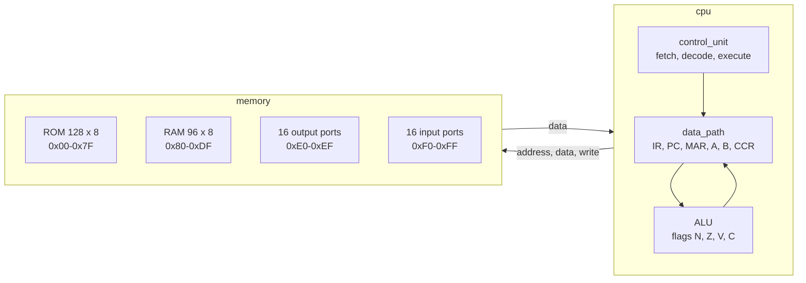

# 8-bit microcontroller in VHDL

An 8-bit microcontroller written in VHDL for a Xilinx Artix-7: a CPU with two accumulators and a four-flag ALU, a 128-byte program ROM, a 96-byte RAM, and 16 input and 16 output ports, all in one memory map. It is simulated in Vivado, module by module and as a whole.

Built in a week (30 May to 2 June 2025) during an internship at KMUTT, Thailand, as a fifth-year student at Polytech Dijon.

## Architecture



| File | Role |
|---|---|
| [microcontroller.vhd](source/microcontroller.vhd) | Top level: the CPU and the memory, with the 16 input and 16 output ports |
| [cpu.vhd](source/cpu.vhd) | The control unit and the data path |
| [control_unit.vhd](source/control_unit.vhd) | The state machine that fetches, decodes and executes each instruction |
| [data_path.vhd](source/data_path.vhd) | The registers (IR, PC, MAR, A, B, CCR), the two internal buses and the ALU |
| [ALU.vhd](8bits%20Ucontroller.srcs/sources_1/new/ALU.vhd) | Add, subtract, AND, OR, increment, decrement, and the N, Z, V and C flags |
| [memory.vhd](source/memory.vhd) | The memory map: ROM, RAM and ports |
| [rom_128x8_sync.vhd](source/rom_128x8_sync.vhd) | The program ROM, with the test program |
| [rw_96x8_sync.vhd](source/rw_96x8_sync.vhd) | The RAM |
| [Output_Ports.vhd](source/Output_Ports.vhd) | The 16 output port registers |
| [ALU_tb.vhd](source/ALU_tb.vhd), [tb_memory.vhd](source/tb_memory.vhd), [tb_microcontroller.vhd](source/tb_microcontroller.vhd) | Testbenches |

[rom_128x8_Async.vhd](source/rom_128x8_Async.vhd), an asynchronous version of the ROM, and [8Bitmicrocontroller.vhd](source/8Bitmicrocontroller.vhd), an empty placeholder, are not part of the Vivado project.

## Instruction set

| Opcode | Instruction | Operation |
|---|---|---|
| 0x86 | `LDA_IMM n` | A ← n |
| 0x87 | `LDA_DIR addr` | A ← memory[addr] |
| 0x88 | `LDB_IMM n` | B ← n |
| 0x89 | `LDB_DIR addr` | B ← memory[addr] |
| 0x96 | `STA_DIR addr` | memory[addr] ← A |
| 0x97 | `STB_DIR addr` | memory[addr] ← B |
| 0x42 | `ADD_AB` | A ← A + B, sets N, Z, V, C |
| 0x43 | `SUB_AB` | A ← A − B, sets N, Z, V, C |
| 0x44 | `AND_AB` | A ← A AND B, sets N, Z, clears V, C |
| 0x45 | `OR_AB` | A ← A OR B, sets N, Z, clears V, C |
| 0x46, 0x47 | `INCA`, `INCB` | increment A, B; sets N, Z, clears V, C |
| 0x48, 0x49 | `DECA`, `DECB` | decrement A, B; sets N, Z, clears V, C |
| 0x20 | `BRA addr` | branch always |
| 0x21–0x28 | `BMI`, `BPL`, `BEQ`, `BNE`, `BVS`, `BVC`, `BCS`, `BCC` | branch if N = 1, N = 0, Z = 1, Z = 0, V = 1, V = 0, C = 1, C = 0 |

Known issue: `INCA` and `DECA` load A with B + 1 and B − 1. The ALU increments and decrements its `A` input, which `data_path.vhd` connects to register B; `INCB` and `DECB` are right.

## Test program

The ROM runs every kind of instruction, then loops:

```
0x00  LDA_IMM 0xAA     0x02  LDA_DIR 0x80
0x04  LDB_IMM 0x44     0x06  LDB_DIR 0x81
0x08  STA_DIR 0x82     0x0A  STB_DIR 0x83
0x0C  ADD_AB   SUB_AB   AND_AB   OR_AB
0x10  INCA     INCB     DECA     DECB
0x14  BCS 0x00         0x16  BCC 0x00
```

## Simulation

Open `8bits Ucontroller.xpr` in Vivado 2024.2 or later, set the simulation top to one of the testbenches and run a behavioural simulation:

- `ALU_tb`: each ALU operation and its flags.
- `tb_memory`: reads and writes across the ROM, the RAM and the ports.
- `tb_microcontroller`: the whole microcontroller running the test program, with the input ports set to 0x00, 0x11 … 0xFF.

The testbenches drive the inputs; the results are read in the waveform viewer.

The project targets an Artix-7 XC7A100T in the FTG256 package and has no pin constraints yet. Running it on a Nexys 4 DDR needs the board's part, XC7A100T-1CSG324, and a constraints file for the clock, the reset and the ports.

## Credits

The architecture, instruction set and state machine follow the example computer in Brock J. LaMeres, *Introduction to Logic Circuits & Logic Design with VHDL* (Springer).
